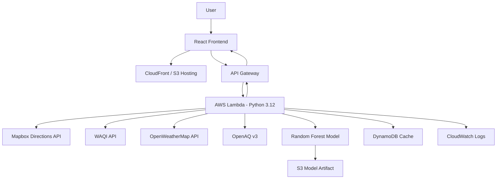

# PATHwise 🌍
### Pollution-Aware Trip Exposure Helper

**Don't just check the AQI. Choose a route with potentially lower pollution exposure.**

PATHwise helps commuters compare routes based on estimated air-pollution exposure, understand the factors behind each recommendation, and explore better departure times.

[**Live Demo**](http://pathwise-web-808454010294.s3-website.ap-south-1.amazonaws.com) · **Built with React, Python, AWS & Machine Learning**

---


### Route Planning & Pollution-Aware Navigation


*Plan a journey, compare alternative routes, and visualize estimated pollution exposure on a map.*

### Route Comparison & Recommendation


*Compare estimated exposure scores, understand the trade-offs, and identify the recommended route.*


*Access trip details and route recommendations through a compact, responsive layout.*

---

## 💡 The Problem

Most air-quality applications report a single AQI value for an entire city or monitoring location. That number alone cannot tell commuters how pollution may vary along their journey.

Two routes to the same destination can differ in traffic conditions, travel duration, and surrounding pollution levels. Similarly, leaving at a different time may change the conditions encountered during a trip.

**The problem:** How can we turn general air-quality information into practical, route-specific exposure estimates that help people make more informed travel decisions?

## 🚀 Our Solution

PATHwise combines air-quality readings, weather conditions, route geometry, traffic information, and machine-learning predictions to estimate relative pollution exposure for alternative routes.

Instead of simply displaying an AQI number, PATHwise aims to answer three practical questions:

- **Which route?** Compare alternative journeys using estimated exposure scores.
- **Why this route?** Explain the factors contributing to the recommendation.
- **When should I leave?** Explore departure-time windows using historical pollution patterns.

The result is a pollution-aware trip planning experience that makes environmental information more actionable.

## ✨ Key Features

| Feature | What it does |
|---|---|
| 🗺️ Route comparison | Visualizes alternative routes on an interactive map |
| 🌫️ Exposure estimation | Calculates relative pollution exposure scores for each route |
| 🎯 Route recommendation | Highlights the route with the lower estimated exposure |
| 🔎 Explainable results | Shows contributing factors behind the recommendation |
| 🕒 Departure-time analysis | Uses historical pollution patterns to identify potentially better travel windows |
| 🔄 Resilient data access | Supports cached results when live data sources are unavailable |
| 📱 Responsive interface | Presents route information in a desktop- and mobile-friendly layout |

## 🧭 How It Works

1. **Enter a journey:** Provide the origin, destination, travel mode, and departure time.
2. **Retrieve route information:** Obtain route geometry, traffic conditions, and estimated travel duration.
3. **Collect environmental data:** Retrieve available air-quality readings and weather information.
4. **Estimate exposure:** Evaluate route segments using environmental features and the trained machine-learning model.
5. **Compare alternatives:** Aggregate segment-level estimates into route exposure scores.
6. **Recommend a route:** Present the preferred option and explain the estimated exposure trade-off.

## 🏗️ Architecture



*The diagram represents the intended application architecture. Refer to the deployment configuration and source code for the services and integrations actually enabled.*

### AWS Integration

PATHwise uses AWS services to host the application, execute backend logic, cache results, store model artifacts, and monitor execution.

| AWS Service | Responsibility |
|---|---|
| **AWS Lambda** | Executes backend logic, exposure calculations, and model inference |
| **Amazon API Gateway** | Exposes the route-analysis API endpoint |
| **Amazon DynamoDB** | Stores cached route results and demo scenarios |
| **Amazon S3** | Stores model artifacts and static frontend assets |
| **Amazon CloudFront** | Provides HTTPS content delivery for the frontend, when configured |
| **Amazon CloudWatch** | Supports logging and error monitoring |

The external APIs supply routing and environmental data, while AWS provides the application infrastructure.

## 🤖 AI/ML Methodology

### Route-Segment Classification

PATHwise uses a pre-trained `RandomForestClassifier` to classify air-quality conditions for route segments.

**Model inputs include:**

- Temperature and humidity
- PM2.5 and PM10 concentrations
- NO₂, SO₂, and CO concentrations
- Traffic-related and location-based contextual features

The classifier predicts an air-quality class, which is mapped to a numerical value for downstream exposure estimation.

### Exposure Estimation

For each route segment:

`segment_score = class_value × time_on_segment_minutes`

The segment scores are aggregated into a time-weighted route exposure estimate and normalized to a 0–100 scale.

The resulting scores are **relative, model-based estimates**, not direct measurements of an individual's inhaled pollution dose or medical risk.

### Departure-Time Analysis

PATHwise uses historical hourly PM2.5 observations from OpenAQ v3 to estimate how pollution patterns may vary across departure times.

When sufficient historical observations are unavailable, the implementation can use a fallback pollution profile based on published CPCB Delhi seasonal averages.

The fallback and its assumptions should be clearly distinguished from live measurements.

## 📊 Demo Results

**Example journey:** Karol Bagh → Lajpat Nagar, Delhi  
**Travel mode:** Driving · **Departure:** 8:00 AM

| Metric | Route A | Route B |
|---|---:|---:|
| Distance | 13.43 km | 14.13 km |
| Estimated travel time | 37.1 min | 39.8 min |
| Exposure score | 68/100 | 51/100 |
| Relative category | High | Moderate |

### Recommended: Route B

In this demo scenario, Route B has an approximately **25% lower estimated exposure score**, despite taking around 2.7 minutes longer.

The recommendation is based on the model's route-level estimates and the environmental data available to the application.

**Important:** These figures describe the demo scenario. They should not be interpreted as a verified real-world reduction in inhaled pollution. The accuracy of the recommendation depends on data coverage, model quality, and the assumptions used in the exposure calculation.

## 🌱 Environmental Impact

PATHwise aims to help commuters make more pollution-aware travel decisions without requiring new transport infrastructure.

Potential benefits include:

- Greater awareness of pollution differences between routes
- Better-informed decisions about travel timing
- Identification of potentially lower-exposure alternatives
- Improved understanding of how environmental conditions affect everyday journeys

The current demo illustrates the concept using relative exposure estimates. City-wide exposure reductions have not been established and would require further validation using real-world observations and user travel data.

## 🛠️ Technology Stack

| Layer | Technologies |
|---|---|
| Frontend | React, JavaScript, Mapbox |
| Backend | Python 3.12, AWS Lambda |
| API | Amazon API Gateway |
| Machine Learning | scikit-learn, Random Forest |
| Storage and caching | Amazon S3, Amazon DynamoDB |
| Monitoring | Amazon CloudWatch |
| Environmental data | WAQI, OpenAQ v3, OpenWeatherMap |
| Routing | Mapbox Directions API |

## 📡 Data Sources

| Source | Data used | Notes |
|---|---|---|
| [WAQI](https://waqi.info/) | Air-quality index and pollutant readings | Check the applicable API terms and usage restrictions |
| [OpenAQ](https://openaq.org/) | Historical air-quality observations | Review dataset-specific licensing and attribution requirements |
| [OpenWeatherMap](https://openweathermap.org/) | Temperature, humidity, and wind conditions | Subject to API plan and usage limits |
| [Mapbox](https://www.mapbox.com/) | Route geometry, traffic, and travel duration | Subject to Mapbox API terms and quotas |
| [Kaggle — Air Quality and Pollution Assessment](https://www.kaggle.com/) | Training data for the classifier | Attribute the exact dataset and verify its license |

Actual data availability varies by location, API plan, and monitoring-station coverage. The implementation should document any missing-data handling, fallback logic, and simulated values.

## ⚙️ Run Locally

### Prerequisites

- Python 3.12
- Node.js and npm
- Git
- API credentials for the external services used by the application
- AWS credentials only if you are running AWS-dependent integration tests or deployment commands

### 1. Clone the repository

```bash
git clone <YOUR_PUBLIC_REPOSITORY_URL>
cd PATHwise
```

### 2. Install backend dependencies

```bash
cd backend
pip install -r requirements.txt
```

Configure the required API keys using your local environment configuration. Never commit real API keys or AWS credentials.

Run the integration tests, if configured:

```bash
RUN_INTEGRATION=1 pytest tests/test_integration_local.py
```

### 3. Start the frontend

Open another terminal:

```bash
cd frontend
npm install
npm run dev
```

Open the local URL printed by the development server.

## ☁️ Deployment

The deployment script is available at:

```bash
bash infra/deploy.sh
```

Deployment requires the AWS CLI, an appropriately configured AWS account, and the necessary IAM permissions.

Review the infrastructure configuration and deployment script before running it. Actual deployed services may differ from the proposed architecture.

## 🌐 Live Demo

- **Web application:** [Open PATHwise](http://pathwise-web-808454010294.s3-website.ap-south-1.amazonaws.com)
- **API endpoint:** `https://9sy49ljh3a.execute-api.ap-south-1.amazonaws.com/analyze-route`
- **CloudFront:** See `infra/cloudfront_config.json` and `infra/deploy_cloudfront.sh` for configuration and deployment status.

The current S3 website URL uses HTTP. Use an HTTPS-enabled deployment for the final public-facing demo where possible.

## 🔮 Future Improvements

- Improve spatial coverage by combining multiple air-quality monitoring sources.
- Validate route-level estimates against observed pollution measurements.
- Incorporate uncertainty and confidence indicators into recommendations.
- Personalize estimates using travel duration and relevant user preferences.
- Evaluate predictions across more cities, weather conditions, and travel modes.
- Measure real-world exposure changes through controlled evaluation.

## Youtube demo link - https://youtu.be/jqwXbUeHRhA?si=TZwLf_bGFQSrgRyf

## 👥 Team

- Sam
- Rohit Sharma
- Priyanshu Attri

## 🧰 AI Tools Used

- **Claude (Anthropic):** Architecture exploration, development assistance, and code-generation support.
- **GitHub Copilot:** Code completion and test-generation assistance.

Generated code and suggestions were reviewed by the team. The repository should reflect the actual tools used and the team's verification of the final implementation.

---

**PATHwise — Make your journey more pollution-aware.**
